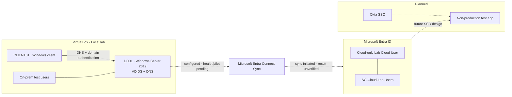

# Hybrid Identity Lab | Active Directory + Microsoft Entra ID

> **Portfolio project · In progress**  
> Building and validating an on-premises Active Directory environment, Microsoft Entra ID, hybrid identity synchronization, and eventually Okta SSO—with screenshots, repeatable checks, and troubleshooting notes.

**Current milestone (last verified evidence: October 21, 2026):** Microsoft Entra Connect Sync setup wizard completed successfully and reported synchronization was initiated. **End-to-end sync is not yet verified.** Documentation reviewed October 26, 2026; no newer technical validation result is recorded yet.

[Roadmap](progress/roadmap.md) · [Build guide](docs/build-guide.md) · [Session log](progress/session-log.md) · [Architecture](docs/architecture.md) · [Troubleshooting](docs/troubleshooting.md)

---

## Start here

| If you're… | Go here |
|---|---|
| A recruiter or reviewer | [Project status](#project-status) and [What this demonstrates](#what-this-project-demonstrates) |
| Following the build | [Build guide](docs/build-guide.md) |
| Looking for completed work | [Progress roadmap](progress/roadmap.md) and [Session log](progress/session-log.md) |
| Troubleshooting | [Troubleshooting guide](docs/troubleshooting.md) |
| Reviewing design | [Architecture](docs/architecture.md) · [Network design](docs/network-design.md) |

## Project status

| Workstream | Status | Verified / observed so far |
|---|---|---|
| VirtualBox foundation | Complete (reported) | Server VMs and snapshots prepared |
| Active Directory + DNS | Validated foundation | Windows Server 2019 DC01; lab domain `skrillsam.org` |
| Windows client | Validated | CLIENT01 joined; PowerShell reported `PartOfDomain = True`; successful secure-channel validation was observed |
| Lab DNS | Validated checks | Zone/records inspected and name-resolution checks performed |
| On-premises test identities | Created | Dedicated lab accounts for directory exercises |
| Entra ID tenant | Initial setup | Tenant portal access established |
| Cloud test objects | Created | Cloud-only `Lab Cloud User` and `SG-Cloud-Lab-Users` |
| Entra Connect Sync | **Configured; validating** | Wizard succeeded and initiated sync; service, scope, connector health, and synced pilot still need validation |
| gMSA practice | In progress | KDS root-key readiness and gMSA validation still to do |
| Okta SSO | Planned | No app integration or end-to-end test recorded |
| Screenshot evidence | Pending | Wizard screenshots reviewed; repository upload/rendering still pending |

### Next actions

1. **Review synchronization scope.** The wizard showed “Synchronize all users and devices.” Verify intended scope and narrow to a pilot OU/group if appropriate before proceeding.
2. **Check sync health.** Confirm Microsoft Entra Connect Sync service/scheduler status and review connector import, synchronization, export, and errors.
3. **Validate a pilot identity.** Verify one known on-premises test user appears in Entra ID with expected source and attributes.
4. Capture sanitized evidence and record the observed outcome.
5. Resume KDS/gMSA validation; plan Okta SSO after the identity foundation is stable.

> **Status integrity:** Wizard completion is not proof of successful end-to-end synchronization. A cloud-only Entra account is not an AD-synchronized identity.

## Architecture at a glance

The local directory/client relationship and cloud objects are established. The sync connection below is **configured but not yet end-to-end validated**; Okta is future scope.



## Lab environment

| Component | Current reference |
|---|---|
| Hypervisor | Oracle VirtualBox |
| Domain | `skrillsam.org` |
| Domain controller | `DC01` · Windows Server 2019 |
| DC host-only IP | `192.168.56.10` |
| Windows client | `CLIENT01` |
| Client host-only IP | `192.168.56.20` |
| Identity platform | Microsoft Entra ID |
| Sync method | Microsoft Entra Connect Sync wizard configured |
| Source anchor shown | `mS-DS-ConsistencyGuid` |
| Authentication option shown | Password hash synchronization |

## Progress highlights

### October 26, 2026 — Documentation checkpoint
- Reviewed the repository status and latest recorded lab evidence.
- No new technical validation output was available for this checkpoint; the last evidenced sync milestone remains the October 21 wizard success/initiation.
- Kept end-to-end synchronization, pilot identity confirmation, and screenshot repository upload marked pending.


### October 21, 2026 — Hybrid sync configuration
- Completed Microsoft Entra Connect Sync configuration wizard.
- Wizard reported configuration succeeded and synchronization was initiated.
- Password hash synchronization was selected; source anchor displayed as `mS-DS-ConsistencyGuid`.
- Follow-up: scope review, service/scheduler health, connector errors, and pilot identity confirmation.

### October 19–20, 2026 — Local identity foundation
- Configured AD DS and DNS on Windows Server 2019 `DC01`.
- Created local lab identities and joined `CLIENT01` to the domain.
- Observed domain membership and secure-channel validation success.
- Inspected DNS zone and lab records.

## Repository guide

- `docs/` — architecture, network design, build guide, troubleshooting, and KDS/gMSA readiness
- `labs/` — practical exercises
- `scripts/` — validation and automation
- `diagrams/` — editable diagrams
- `screenshots/` — intended home for sanitized milestone evidence (upload still pending)
- `progress/roadmap.md` — task checklist and current status
- `progress/session-log.md` — dated milestones and evidence notes

## What this project demonstrates

- Active Directory Domain Services and DNS foundations
- Windows domain join and secure-channel troubleshooting
- PowerShell-based validation and operational checks
- Cloud identity object administration
- Hybrid identity configuration and evidence-led verification
- Security-aware lab documentation, scope review, and troubleshooting discipline

## Validation quick start

**On DC01 (elevated PowerShell):**
```powershell
Get-ADDomain
Get-ADForest
Get-Service DNS, NTDS, Netlogon
dcdiag /test:dns /v
Get-KdsRootKey
```

**On CLIENT01:**
```powershell
ipconfig /all
nslookup skrillsam.org
nltest /dsgetdc:skrillsam.org
Test-ComputerSecureChannel -Verbose
(Get-CimInstance Win32_ComputerSystem).PartOfDomain
```

**For gMSA practice:** from an authorized test host with the AD module:
```powershell
Test-ADServiceAccount -Identity <gMSAName>
```

Run commands in the appropriate context; compare with documented expected behavior and record actual results. For sync, check the Connect Sync service, scheduler, connector status, errors, and a test identity before claiming success.

## Security and portfolio standards

- Never commit passwords, tokens, recovery codes, private keys, client secrets, or credential exports.
- Use test identities and least privilege. Review synchronization scope before broad directory sync.
- Keep domain controllers and management interfaces off the public internet.
- Sanitize screenshots: remove secrets, personal details, unnecessary tenant identifiers, public IPs, and employer/customer information.
- Record objective, steps, expected result, observed result, and remediation.
- Only label a milestone complete when supporting validation evidence exists.

---

*Learning portfolio. Status labels distinguish completed, observed, configured, validating, and planned work. Integration claims will be updated as new evidence is captured.*
