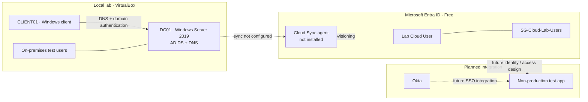

# Hybrid Identity Engineering Lab

<p align="center">
  <strong>Active Directory · Microsoft Entra ID · Hybrid Identity · Okta SSO · Zero Trust</strong>
</p>

<p align="center">
  
  
  
  
</p>

A practical, evidence-driven lab for building and troubleshooting on-premises Active Directory, Microsoft Entra ID, identity synchronization, and Okta single sign-on. This repository distinguishes completed and observed work from planned integration so the portfolio remains technically accurate.

> **Current milestone (October 21, 2026):** The local AD DS/DNS foundation and Windows client domain membership are validated. A Microsoft Entra ID Free tenant is in use, and a cloud-only test user plus a cloud security group have been created. Hybrid synchronization is **not configured**: the Entra Cloud Sync Agents view returned no results, and no provisioning agent has been installed. Okta SSO remains planned.

## Lab at a glance

| Area | Current status | Notes |
|---|---|---|
| VirtualBox lab foundation | Complete | Windows Server virtual machines and snapshots prepared |
| Active Directory Domain Services | Complete | Domain: `skrillsam.org`; domain controller: `DC01` |
| Lab network | Configured | Host-only network; DC01: `192.168.56.10`; Windows client: `192.168.56.20` |
| Domain-joined Windows client | Validated | PowerShell reported `PartOfDomain = True`; secure-channel validation was observed as successful |
| DNS | Validated | DNS zone and lab records inspected; name-resolution checks performed |
| On-premises test identities | Complete | Local lab users created for directory and authentication exercises |
| Microsoft Entra ID tenant | Initial setup complete | Microsoft Entra ID Free tenant selected and portal access established |
| Cloud-only test identity | Complete | `Lab Cloud User` created in Entra ID; separate from on-premises AD users |
| Cloud security group | Complete | `SG-Cloud-Lab-Users` created for cloud identity exercises |
| Entra Cloud Sync agent | Not installed | Cloud Sync Agents view showed no results; installation and prerequisite checks remain |
| Hybrid identity synchronization | Not configured | No successful synchronization or synced identity has been validated yet |
| KDS root key / gMSA | In progress | Check root-key state and effective safety interval before gMSA validation |
| Okta SSO | Planned | No application integration or end-to-end SSO test documented yet |
| Screenshot evidence | Pending repository verification | Add sanitized screenshots to `screenshots/` and verify that they render on GitHub |

## Architecture

The solid connections below represent the validated local lab. The cloud identity objects exist, but the dotted synchronization and SSO paths are **target state**, not completed integrations.



## Recent progress log

### October 21, 2026 — Entra setup and synchronization readiness
- Confirmed a Microsoft Entra ID Free tenant is available for the lab.
- Created the cloud-only test identity `Lab Cloud User`.
- Created the cloud security group `SG-Cloud-Lab-Users`.
- Opened the Cloud Sync agent area; it returned **No results**.
- Recorded the important boundary: no provisioning agent is installed and hybrid synchronization is not yet configured. Do not claim synced users or a working hybrid identity connection until an end-to-end test succeeds.

### October 19–20, 2026 — Local directory and client validation
- Built the `skrillsam.org` AD DS domain on Windows Server 2019 `DC01`.
- Created local test identities and joined the Windows client to the domain.
- Observed successful domain-membership and secure-channel validation.
- Inspected DNS zone and lab host records.

## Learning path

| Stage | What you'll build | Evidence to capture |
|---|---|---|
| 01 — Foundation | VirtualBox network, VM roles, checkpoints | VM settings and network diagram |
| 02 — Active Directory | AD DS, DNS, users, groups, domain join | ADUC, domain details, validation output |
| 03 — Service accounts | KDS root key and a test gMSA | Root-key state, authorized host validation, sanitized output |
| 04 — Entra ID | Tenant, cloud-only user, cloud group, admin safety | Sanitized tenant and object screenshots |
| 05 — Hybrid identity | Install supported sync component and define pilot scope | Agent health, sync status, test-user validation |
| 06 — Okta SSO | Test app, sign-in flow, access decisions | App configuration overview and redacted test results |
| 07 — Hardening | Least privilege, sign-in controls, recovery plan | Security checklist and troubleshooting records |

## Repository map

- [`docs/architecture.md`](docs/architecture.md) — design, components, and target-state diagram
- [`docs/network-design.md`](docs/network-design.md) — network assumptions, DNS, and connectivity checks
- [`docs/build-guide.md`](docs/build-guide.md) — milestone-based build and validation guide
- [`docs/troubleshooting.md`](docs/troubleshooting.md) — repeatable diagnostic workflow
- [`docs/kds-gmsa-readiness.md`](docs/kds-gmsa-readiness.md) — KDS root-key checks and gMSA validation checklist
- [`diagrams/authentication-flow.mmd`](diagrams/authentication-flow.mmd) — editable authentication-flow diagram
- [`labs/`](labs/) — step-by-step lab exercises
- [`scripts/`](scripts/) — validation and automation scripts
- [`screenshots/`](screenshots/) — visual evidence, organized by milestone
- [`progress/roadmap.md`](progress/roadmap.md) — completion checklist and next actions
- [`progress/session-log.md`](progress/session-log.md) — dated accomplishment and status log

## Validation quick start

Run these from the appropriate lab machine and compare the results with the documented expected state.

**On the domain controller (elevated PowerShell):**
```powershell
Get-ADDomain
Get-ADForest
Get-Service DNS, NTDS, Netlogon
dcdiag /test:dns /v
Get-KdsRootKey
```

**On the domain-joined client:**
```powershell
ipconfig /all
nslookup skrillsam.org
nltest /dsgetdc:skrillsam.org
Test-ComputerSecureChannel -Verbose
(Get-CimInstance Win32_ComputerSystem).PartOfDomain
```

For a gMSA, validate from an authorized test host with the Active Directory module available:
```powershell
Test-ADServiceAccount -Identity <gMSAName>
```

For Entra ID, confirm the active directory/tenant in the portal before changing configuration. A cloud-only user is not evidence of directory synchronization. Do not mark hybrid identity complete until a supported sync agent is installed, healthy, scoped intentionally, and a pilot identity is validated end-to-end.

## Security and evidence standards

- Never commit passwords, access tokens, private keys, recovery codes, or exported credential files.
- Use dedicated test identities and least-privilege access for experiments.
- Keep domain controllers and management interfaces off the public internet.
- Redact personal identifiers, tenant IDs where unnecessary, public IPs, and employer/customer information in screenshots.
- Take a VM snapshot before high-impact changes and document rollback steps.
- For each lab, record the objective, commands or UI steps, expected result, observed result, and remediation.
- Do not mark a feature complete based only on opening a portal or starting a wizard; capture a successful validation result.

## What this project demonstrates

Hands-on identity infrastructure, Active Directory and DNS troubleshooting, PowerShell validation, cloud identity object administration, hybrid identity readiness assessment, SSO concepts, security-minded documentation, and evidence-based problem solving.

---

**Built as a learning portfolio.** Features marked *planned* or *not configured* are not represented as implemented until configuration and validation evidence are documented.
