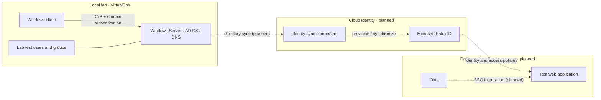

# Hybrid Identity Engineering Lab

<p align="center">
  <strong>Active Directory · Microsoft Entra ID · Hybrid Identity · Okta SSO · Zero Trust</strong>
</p>

<p align="center">
  
  
  
  
</p>

A practical, evidence-driven lab for building and troubleshooting an on-premises Active Directory environment and extending it toward Microsoft Entra ID, identity synchronization, and Okta single sign-on. This repository documents the build, the tests, what worked, and what still needs to be completed.

> **Portfolio note:** The local Active Directory foundation is in place. Entra ID integration and Okta SSO are roadmap items until their configuration and validation evidence are added here.

## Lab at a glance

| Area | Current status | Notes |
|---|---|---|
| VirtualBox lab foundation | Complete | Windows Server virtual machines and snapshots prepared |
| Active Directory Domain Services | Complete | Lab domain: `skrillsam.org` |
| Domain-joined Windows client | Complete | Reported client address: `192.168.56.20` |
| Test identities | Complete | Test users created for directory and authentication exercises |
| Microsoft Entra tenant | Next | Tenant setup and safe lab configuration |
| Hybrid identity / sync | Planned | Configure only after tenant and source-directory readiness checks |
| Okta SSO | Planned | Add an application integration and document sign-in tests |
| Security validation and evidence | In progress | Add sanitized screenshots, command output, and troubleshooting notes |

## Target architecture

The diagram below is the **target state**, not a claim that all cloud connections are already configured.



## Learning path

| Stage | What you'll build | Evidence to capture |
|---|---|---|
| 01 — Foundation | VirtualBox network, VM roles, checkpoints | VM settings and network diagram |
| 02 — Active Directory | AD DS, DNS, users, groups, domain join | ADUC, domain details, validation output |
| 03 — Entra ID | Lab tenant and baseline security settings | Sanitized tenant setup notes |
| 04 — Hybrid identity | Sync prerequisites, scope, health checks | Sync status and a test-user validation |
| 05 — Okta SSO | Test app, sign-in flow, access decisions | App configuration overview and redacted test results |
| 06 — Hardening | Least privilege, sign-in controls, recovery plan | Security checklist and troubleshooting records |

## Repository map

- **[`docs/architecture.md`](docs/architecture.md)** — design, components, and target-state diagram
- **[`docs/network-design.md`](docs/network-design.md)** — network assumptions, DNS, and connectivity checks
- **[`docs/build-guide.md`](docs/build-guide.md)** — milestone-based build and validation guide
- **[`docs/troubleshooting.md`](docs/troubleshooting.md)** — repeatable diagnostic workflow
- **[`diagrams/authentication-flow.mmd`](diagrams/authentication-flow.mmd)** — editable authentication-flow diagram
- **[`labs/`](labs/)** — step-by-step lab exercises
- **[`scripts/`](scripts/)** — validation and automation scripts
- **[`screenshots/`](screenshots/)** — sanitized visual evidence, organized by milestone
- **[`progress/roadmap.md`](progress/roadmap.md)** — completion checklist and next actions

Supporting guides, roadmap checklists, and evidence instructions are now included. Screenshot evidence itself will be added as each milestone is completed.

## Validation quick start

Run these from the appropriate lab machine and compare the results with the documented expected state.

**On the domain controller (elevated PowerShell):**
```powershell
Get-ADDomain
Get-ADForest
Get-Service DNS, NTDS, Netlogon
dcdiag /test:dns /v
```

**On the domain-joined client:**
```powershell
ipconfig /all
nslookup skrillsam.org
nltest /dsgetdc:skrillsam.org
Test-ComputerSecureChannel -Verbose
```

These commands are validation examples; capture and review the actual output from your environment rather than assuming a successful result.

## Security and evidence standards

- Never commit passwords, access tokens, private keys, recovery codes, or exported credential files.
- Use dedicated test identities and least-privilege access for experiments.
- Keep domain controllers and management interfaces off the public internet.
- Redact personal identifiers, tenant IDs where unnecessary, public IPs, and any employer/customer information in screenshots.
- Take a VM snapshot before high-impact changes and document rollback steps.
- Include the test objective, commands or UI steps, expected result, observed result, and remediation for each lab.

## What this project demonstrates

Hands-on identity infrastructure, Active Directory and DNS troubleshooting, PowerShell validation, hybrid identity planning, SSO concepts, security-minded documentation, and evidence-based problem solving.

---

**Built as a learning portfolio.** Features marked *planned* are not represented as implemented until configuration and validation evidence are documented.
