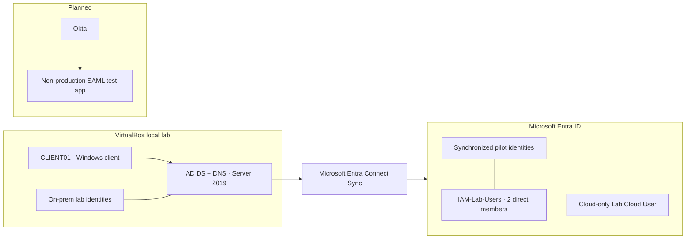

# Hybrid Identity Lab | Active Directory + Microsoft Entra ID

> **Portfolio project · In progress**  
> Hands-on identity lab covering on-premises Active Directory, Microsoft Entra ID, hybrid synchronization, managed service accounts, and planned Okta SSO.

**Current checkpoint — October 26, 2026:** Hybrid pilot provisioning, sample attribute flow, and synchronized group membership have been validated. Existing gMSA `gmsaLabSvc` passed host-side validation on Server 2022; scheduled task `gMSA-Lab-Test` completed with result `0` and wrote its output. Okta SSO has not started.

[Roadmap](progress/roadmap.md) · [Build guide](docs/build-guide.md) · [Session log](progress/session-log.md) · [Architecture](docs/architecture.md) · [Troubleshooting](docs/troubleshooting.md) · [Screenshot evidence](screenshots/README.md)

## Project status

| Workstream | Status | Validation boundary |
|---|---|---|
| VirtualBox foundation | Prepared (reported) | Lab VMs/snapshots established; inventory details can be expanded |
| Active Directory + DNS | Core foundation validated | Windows Server 2019 DC; `skrillsam.org`; DNS and client checks observed |
| Windows client | Validated | `CLIENT01` domain membership and secure-channel validation observed |
| Entra ID | Initial setup | Cloud-only `Lab Cloud User` and `SG-Cloud-Lab-Users` created |
| Entra Connect Sync | Pilot validated | Service/scheduler and connector operations observed; pilot identity, attribute, and group results confirmed |
| Password Hash Sync | Configured; sign-in reported | Feature output `True`; user reported successful sign-ins. No isolated PHS sign-in event captured |
| Hybrid group sync | Validated | AD `IAM-Lab-Users`; Ephraim Boss and Hybrid Test User confirmed as direct members in Entra |
| gMSA exercise | Core test validated | Existing account `gmsaLabSvc`; `Test-ADServiceAccount=True`; task result `0` and output file observed |
| gMSA runtime identity audit | Pending | Task principal configured; independent runtime identity evidence not confirmed |
| Application assignment / RBAC | Not tested | No application access allow/deny exercise documented |
| Conditional Access | Not configured | Creation was unavailable due to tenant licensing |
| Okta SSO | Planned | No tenant, app integration, or end-to-end test yet |
| Evidence | Partially published | Four additional dated images in AD evidence folder; visual/caption/render check pending |

## Architecture at a glance

The on-premises domain and client, pilot synchronization, sample attribute flow, and group membership sync have been demonstrated. Scope review and deeper ongoing health validation remain.

## Lab environment

| Component | Reference |
|---|---|
| Hypervisor | Oracle VirtualBox |
| AD domain | `skrillsam.org` |
| Domain controller | Windows Server 2019 |
| DC host-only IP | `192.168.56.10` |
| Windows client | `CLIENT01` |
| Client host-only IP | `192.168.56.20` |
| Hybrid sync | Microsoft Entra Connect Sync |
| Source anchor shown | `mS-DS-ConsistencyGuid` |
| Authentication option selected | Password hash synchronization |

## Progress highlights

### Hybrid identity
- Pilot identity Ephraim Boss appeared in Entra as synchronized.
- AD Department value `IT-Lab` was observed flowing to Entra.
- `Hybrid Test User` was provisioned and appeared in Entra.
- `IAM-Lab-Users` membership was synchronized; two direct members confirmed.
- Delta sync returned `Success`.

### gMSA
- Reused existing `gmsaLabSvc`; did not create a duplicate.
- Retrieval group: `gMSA-Server2022-Hosts`.
- Test host: `WIN-7UDT986C0L5`.
- `Test-ADServiceAccount gmsaLabSvc` returned `True`.
- Scheduled task `gMSA-Lab-Test` returned `LastTaskResult=0`; test output was written.
- Independent runtime identity audit remains pending.

### Current next actions
1. Begin Okta tenant enrollment and confirm actual plan/feature eligibility.
2. Choose the intended SSO architecture and identity source before connecting systems.
3. Configure a non-production SAML app and test both assigned and unassigned user paths.
4. Review actual Entra Connect scope; a wizard step showed “Synchronize all users and devices.”
5. Finish gMSA runtime identity audit and screenshot evidence cleanup.

> **Status integrity:** Practical cloud sign-in was user-reported; the exact authentication path was not isolated in a captured sign-in log. Wizard completion is not itself proof of successful sync. Conditional Access is not configured. A cloud-only identity is not an AD-synchronized identity.

## Repository guide

- `docs/` — build, architecture, network design, troubleshooting, and readiness references
- `labs/` — lab procedures
- `progress/` — roadmap and dated session log
- `screenshots/` — milestone evidence grouped by phase
- `scripts/` — repeatable checks

## What this project demonstrates

- Windows Server AD DS and DNS foundation
- Domain join and identity troubleshooting
- Hybrid user provisioning and attribute/group synchronization
- Identity source and cloud-only versus synchronized object distinctions
- gMSA host readiness and scheduled-task exercise
- Evidence-based technical documentation and security-conscious redaction
- Planned SAML SSO and IAM access validation

## Portfolio standards

- Separate observed results from configuration, user-reported outcomes, and plans.
- Use test identities and non-production applications.
- Never commit passwords, tokens, recovery codes, private keys, or authentication cookies.
- Keep evidence concise, readable, and minimally redacted.
- Record errors and limitations honestly.
