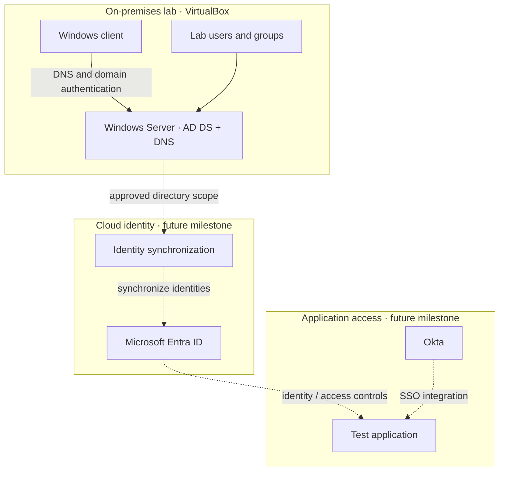

# Lab Architecture

## Purpose

This lab demonstrates the progression from a local Active Directory domain to a hybrid identity environment and application single sign-on. The local foundation is reported as configured; cloud integrations remain planned until implemented and tested.

## Current lab components

| Component | Role | Status |
|---|---|---|
| VirtualBox | Hosts the lab virtual machines | Configured |
| Windows Server domain controller | AD DS and DNS for `skrillsam.org` | Configured |
| Windows client | Domain-joined test workstation | Configured; reported address `192.168.56.20` |
| Test users | Non-production identities for validation | Created |
| Microsoft Entra ID | Cloud identity platform | Planned |
| Identity synchronization | Synchronizes approved directory objects | Planned |
| Okta | SSO / identity-provider integration exercises | Planned |

## Target-state diagram

Dashed connections indicate planned work, not verified connectivity.

## Design principles

- **Separate lab and production:** use test identities and non-production applications only.
- **Least privilege:** use separate administrative and standard test accounts where practical.
- **DNS first:** domain discovery and AD authentication depend on correct client DNS configuration.
- **Small sync scope:** when hybrid synchronization is added, begin with a dedicated test OU and a documented pilot.
- **Evidence-based status:** mark a milestone complete only after capturing a successful test and its sanitized evidence.
- **Rollback:** take and verify a VM snapshot before major directory, networking, or synchronization changes.

## Authentication concepts

- **Kerberos / AD DS:** on-premises domain authentication, dependent on DNS, time, and domain-controller health.
- **Microsoft Entra ID:** cloud identity and access management. A personal Microsoft account is not the same thing as an organizational Entra tenant.
- **Hybrid identity:** identity objects are represented across on-premises and cloud systems through a deliberately configured synchronization or federation design.
- **Okta SSO:** a separate integration exercise. Its exact relationship to Entra ID depends on the chosen application and sign-in design; do not assume a specific federation path before documenting the design.

## Acceptance criteria

1. Client resolves the AD domain and locates a domain controller.
2. AD DS, DNS, and Netlogon services are healthy.
3. A test user can complete the intended domain sign-in.
4. Tenant setup is documented without secrets.
5. Any synchronization pilot has a defined scope, health check, and rollback plan.
6. SSO test cases record expected and observed outcomes, including a denied-access case.
