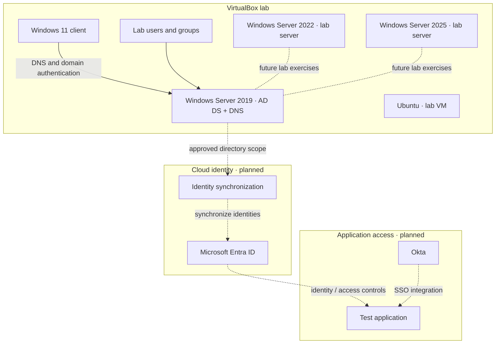

# Lab Architecture

## Purpose

This lab demonstrates the progression from a local Active Directory domain to a hybrid identity environment and application single sign-on. The local foundation is configured; cloud integrations remain planned until implemented and tested.

## Current lab components

| Component | Role | Status |
|---|---|---|
| VirtualBox | Hosts the lab virtual machines | Configured |
| Windows Server 2019 | Active Directory Domain Services and DNS for `skrillsam.org` | Domain controller configured |
| Windows Server 2022 | Additional Windows Server lab VM for later identity / infrastructure exercises | Installed; role-specific configuration should be documented as it is completed |
| Windows Server 2025 | Additional Windows Server lab VM | Present in VM inventory |
| Windows 11 client | Domain-joined test workstation | Configured; reported address `192.168.56.20` |
| Ubuntu | Linux lab VM | Present in VM inventory |
| Test users | Non-production identities for validation | Created in Active Directory |
| KDS root key / gMSA | Managed service-account exercise | In progress; validate key effectiveness before gMSA testing |
| Microsoft Entra ID | Cloud identity platform | Planned |
| Identity synchronization | Synchronizes approved directory objects | Planned |
| Okta | SSO / identity-provider integration exercises | Planned |

## Target-state diagram

Dashed connections indicate planned work, not verified connectivity.

## Design principles

- **Separate lab and production:** use test identities and non-production applications only.
- **Least privilege:** use separate administrative and standard test accounts where practical.
- **DNS first:** domain discovery and AD authentication depend on correct client DNS configuration.
- **Small sync scope:** when hybrid synchronization is added, begin with a dedicated test OU and a documented pilot.
- **Evidence-based status:** mark a milestone complete only after capturing a successful test and its sanitized evidence.
- **Rollback:** take and verify a VM snapshot before major directory, networking, or synchronization changes.

## Authentication concepts

- **Kerberos / AD DS:** on-premises domain authentication, dependent on DNS, time, and domain-controller health.
- **Microsoft Entra ID:** cloud identity and access management, to be configured in a dedicated lab tenant.
- **Hybrid synchronization:** planned; use a supported Microsoft design and a small pilot scope.
- **Okta SSO:** planned; validate both allowed and denied access to a non-production test application.
