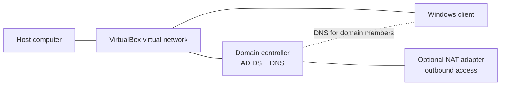

# Lab Network and DNS Design

## Known facts

- Hypervisor: Oracle VirtualBox.
- AD domain: `skrillsam.org`.
- Domain-joined client address reported during setup: `192.168.56.20`.
- Windows Server virtual machines are available in the lab.

The exact subnet, gateway, DHCP mode, and domain-controller address are not documented here yet. Verify those values in VirtualBox and on the machines before making changes.

## Recommended isolation pattern

Use a dedicated **Host-only** or **Internal Network** segment for lab-only AD traffic. Add a separate NAT adapter only when a VM needs outbound internet access. Avoid bridging a domain controller directly onto an untrusted physical network.

Example logical pattern (adapt to the actual lab):



Do not copy an example IP or gateway without confirming the actual network. A domain member should normally use the AD DNS server for its domain lookups, not a public DNS resolver directly.

## Record the actual settings

On each VM, run:

```powershell
ipconfig /all
Get-NetIPConfiguration
Get-NetAdapter
```

Record the adapter name, IPv4 address/prefix, gateway, DNS server, and whether the address is static or DHCP-assigned. Do not publish public IPs or unrelated host network details in screenshots.

## Client validation

Run from the domain-joined Windows client:

```powershell
ipconfig /all
nslookup skrillsam.org
nltest /dsgetdc:skrillsam.org
Test-ComputerSecureChannel -Verbose
```

Expected outcomes:
- DNS queries for the AD domain are answered by the intended lab DNS server.
- Domain-controller discovery returns the expected domain controller.
- The secure-channel test returns `True` when the machine trust is healthy.

If a command fails, capture the exact error and investigate before changing network settings.

## Domain-controller validation

Run from an elevated PowerShell session on the domain controller:

```powershell
Get-Service DNS, NTDS, Netlogon
Get-ADDomain
Get-ADForest
dcdiag /test:dns /v
```

Confirm the services are running and review diagnostic warnings instead of treating command completion alone as proof of health.

## DNS troubleshooting order

1. Confirm the client is on the intended VirtualBox network.
2. Confirm the client DNS server points to the lab AD DNS server.
3. Test basic reachability to the DNS server using its verified IP.
4. Query the domain and domain-controller locator records.
5. Check DNS and Netlogon services and run `dcdiag /test:dns`.
6. Review time synchronization and firewall rules if discovery or authentication still fails.

Do not disable the firewall globally as a troubleshooting shortcut. Use scoped diagnostics and document any rule changes.
